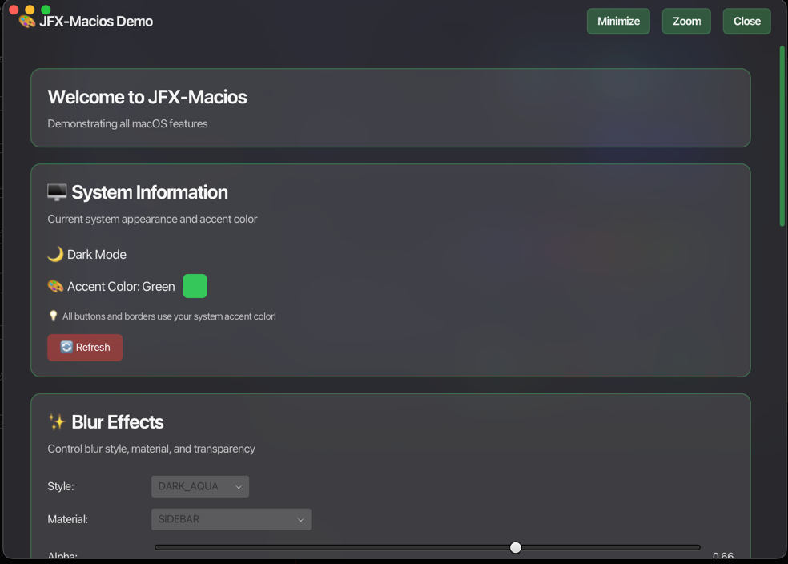
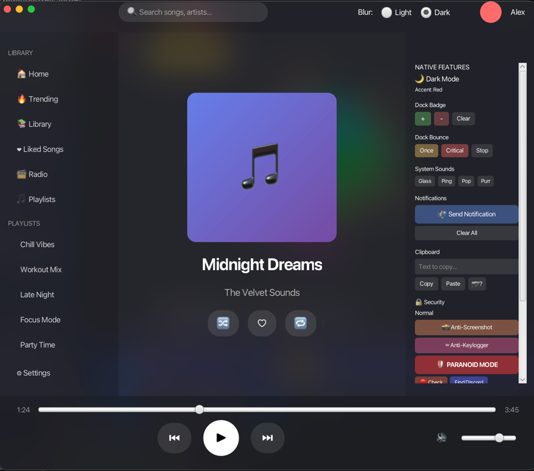

# JFX-Macios

Native macOS integration for **JavaFX**, written in pure Java on top of [JNA](https://github.com/java-native-access/jna). No Xcode, no native compilation, no `.dylib` to ship — just add the dependency and call into AppKit from your JavaFX app.

<p align="center">
  
  
  
  
  
</p>

> **Status:** beta. The API is usable and stable for experimentation, but may still change before `1.0`.

---

## Contents

- [Why](#why)
- [Demo](#demo)
- [Features](#features)
- [Installation](#installation)
- [Getting started](#getting-started)
- [Usage](#usage)
  - [Window effects](#window-effects)
  - [Title bar & window controls](#title-bar--window-controls)
  - [Window security](#window-security)
  - [Menu bar (NSMenu)](#menu-bar-nsmenu)
  - [Dock menu & badge](#dock-menu--badge)
  - [Menu-bar status item (tray)](#menu-bar-status-item-tray)
  - [Notifications](#notifications)
  - [Now Playing & media keys](#now-playing--media-keys)
  - [Touch ID / biometrics](#touch-id--biometrics)
  - [System sounds & haptics](#system-sounds--haptics)
  - [Theme & accent color](#theme--accent-color)
- [Architecture](#architecture)
- [Requirements](#requirements)
- [Building & running the demo](#building--running-the-demo)
- [Contributing](#contributing)
- [License](#license)

---

## Why

JavaFX has no built-in access to modern macOS UI and system APIs. JFX-Macios bridges that gap directly through the Objective-C runtime, so your JavaFX app can look and behave like a native Mac app:

- **No Xcode / no native build step** — everything runs through JNA at runtime.
- **Native look & feel** — real `NSVisualEffectView` blur, transparent title bars, native traffic lights.
- **Deep system integration** — menu bar, Dock menu & badge, notifications, Now Playing, Touch ID, haptics.
- **Lightweight** — the only runtime dependency is JNA.

---

## Demo

<p align="center">
  
</p>

<p align="center">
  
</p>

<p align="center">
  
</p>

---

## Features

| Area | Feature | Status |
|------|---------|:------:|
| Effects | `NSVisualEffectView` blur (Light / Dark / Aqua / Dark Aqua) | ✅ |
| Effects | 18 materials (Sidebar, Menu, Popover, HUD, …) | ✅ |
| Effects | Alpha / transparency control | ✅ |
| Window | Transparent / hidden title bar with native traffic lights | ✅ |
| Window | Native window drag | ✅ |
| Window | Close / minimize / zoom | ✅ |
| Security | Screenshot & screen-recording protection | ✅ |
| Menus | Custom app **menu bar** (`NSMenu`), sticky across focus changes | ✅ |
| Menus | **Dock menu** (right-click the Dock icon) | ✅ |
| Menus | Menu-bar **status item** (tray) with clickable items | ✅ |
| System | Dock **badge** (unread count / text) | ✅ |
| System | Native **notifications** (+ action button, inline reply, image, callbacks) | ✅ |
| System | **Now Playing** (`MPNowPlayingInfoCenter`) + media-key handling | ✅ |
| Security | **Touch ID / biometrics** (`LocalAuthentication`) | ✅ |
| System | System sounds | ✅ |
| System | Haptic feedback (Force Touch trackpad) | ✅ |
| System | Dark-mode detection & accent color | ✅ |
| Security | Keychain | ⚠️ deprecated |

---

## Installation

Build artifact coordinates (`group = evo.developers.ru`, `artifactId = jfx-macios`).

The library is not yet on Maven Central. For now, publish to your local Maven repository:

```bash
cd macios
gradle publishToMavenLocal
```

Then depend on it:

```groovy
repositories {
    mavenLocal()
    mavenCentral()
}

dependencies {
    implementation 'evo.developers.ru:jfx-macios:1.0-SNAPSHOT'
    implementation 'net.java.dev.jna:jna:5.18.1'
    implementation 'net.java.dev.jna:jna-platform:5.18.1'
}
```

---

## Getting started

`HelperMacOS` is the single entry point. Create it once per `Stage`, then reach every feature through its getters.

```java
import evo.developers.ru.macios.HelperMacOS;
import evo.developers.ru.macios.effects.BlurEffectManager;
import javafx.application.Application;
import javafx.application.Platform;
import javafx.scene.Scene;
import javafx.scene.layout.StackPane;
import javafx.scene.paint.Color;
import javafx.stage.Stage;
import javafx.stage.StageStyle;

public class App extends Application {
    @Override
    public void start(Stage stage) {
        stage.setTitle("My App");
        stage.initStyle(StageStyle.UNIFIED);

        HelperMacOS helper = HelperMacOS.getInstance(stage);

        Scene scene = new Scene(new StackPane(), 900, 600);
        scene.setFill(Color.TRANSPARENT);          // let the native blur show through
        stage.setScene(scene);

        // Native calls must run after the window exists.
        stage.setOnShown(e -> Platform.runLater(() -> {
            helper.getTitleBarManager().setupTransparentTitlebar(stage.getTitle());
            helper.getBlurEffect().apply(stage, BlurEffectManager.Style.DARK_AQUA);
        }));

        stage.show();
    }

    public static void main(String[] args) { launch(args); }
}
```

> **Note:** many methods identify the target window by its title (`stage.getTitle()`), so give each window a unique, stable title. Call native APIs after `stage` is shown (e.g. from `setOnShown` + `Platform.runLater`).

---

## Usage

### Window effects

```java
BlurEffectManager blur = helper.getBlurEffect();

blur.apply(stage, BlurEffectManager.Style.DARK_AQUA); // LIGHT | DARK | AQUA | DARK_AQUA
blur.setMaterial(Material.SIDEBAR);                    // 18 materials available
blur.setAlpha(0.85);                                   // 0.0 – 1.0
```

### Title bar & window controls

```java
TitleBarManager bar = helper.getTitleBarManager();

bar.setupTransparentTitlebar(stage.getTitle()); // full-size content + native traffic lights
bar.enableWindowDrag(stage.getTitle());

// Drive a native drag from your custom header:
header.setOnMousePressed(e -> bar.startWindowDrag(stage.getTitle()));

// Window operations:
WindowManager.minimizeWindow();
WindowManager.zoomWindow();
WindowManager.closeWindow();
```

### Window security

```java
WindowSecurity security = helper.getWindowSecurity();

security.setSecure(stage.getTitle(), true);       // hide from screenshots & screen recording
boolean secure = security.isSecure(stage.getTitle());
```

### Menu bar (NSMenu)

Install a custom application menu bar. The standard app menu (About / Hide / Quit) is added automatically; add your own top-level menus with a fluent builder. The menu stays installed even after the app loses and regains focus.

```java
helper.getMenuBar()
    .appName("My App")
    .addMenu("File", m -> m
        .item("New Window", "n", () -> openWindow())
        .item("Save", "s", () -> save())
        .separator()
        .appItem("Close", "performClose:", "w"))   // wire to a standard NSApp selector
    .addMenu("View", m -> m
        .item("Bring to Front", () -> stage.toFront()))
    .apply();
```

- `item(title, action)` / `item(title, keyEquivalent, action)` — runs a Java `Runnable` on the JavaFX thread.
- `appItem(title, selector, key)` — wires an item to a standard `NSApp` selector (e.g. `terminate:`, `performClose:`, `hide:`).
- `separator()` — adds a divider.

### Dock menu & badge

Menu shown when the user **right-clicks the Dock icon**:

```java
helper.getDockMenu().setMenu(m -> m
    .item("New Window", () -> openWindow())
    .separator()
    .item("Say Hello", () -> greet()));
```

Unread badge on the Dock icon:

```java
DockBadgeManager.setDockBadge(5);      // number
DockBadgeManager.setDockBadge("99+");  // text
DockBadgeManager.clearDockBadge();
```

### Menu-bar status item (tray)

```java
StatusBarManager tray = helper.getStatusBar();

tray.show("◆");                  // text title
tray.setSymbolIcon("sparkles");  // or an SF Symbol (macOS 11+)
tray.addItem("Open", () -> stage.toFront());
tray.addSeparator();
tray.addQuitItem("Quit");

tray.remove();                   // when you're done
```

### Notifications

```java
// Simple
NotificationManager.sendNotification("New message", "You have 1 unread message", "msg-1");

// With subtitle
NotificationManager.sendNotification("New message", "John", "Hey there!", "msg-1");

// Rich: action button, inline reply, content image
NotificationManager.sendRich(
    "New message", "John", "Hey there!", "msg-1",
    "Reply",                 // action button title
    true,                    // show inline reply field
    "Type a reply…",         // reply placeholder
    "/path/to/image.png");   // content image (or null)

// Handle interactions
NotificationManager.setListener((id, activationType, replyText) -> {
    if (activationType == NotificationManager.ACTIVATION_REPLIED) {
        System.out.println("Reply to " + id + ": " + replyText);
    }
});

NotificationManager.clearNotifications();
```

> Action & reply buttons only appear when the app's notification style is set to **Alerts** (System Settings → Notifications), not Banners.

### Now Playing & media keys

```java
NowPlayingManager np = helper.getNowPlaying();

np.setNowPlaying("Liquid Dreams", "JFX Macios", "Album", 240, 0); // title, artist, album, duration, elapsed (s)
np.setPlaybackState(NowPlayingManager.STATE_PLAYING);             // STATE_PLAYING | STATE_PAUSED | STATE_STOPPED

// React to media keys / Control Center (handlers return true when handled):
np.enableRemoteCommands();
np.onToggle(() -> { togglePlayback(); return true; });
np.onNext(()   -> { next();           return true; });
np.onPrevious(() -> { previous();     return true; });

np.clear();
```

### Touch ID / biometrics

```java
if (BiometricManager.isBiometricsAvailable()) {
    helper.getBiometric().authenticate("Confirm your identity to continue", (ok, error) -> {
        Platform.runLater(() -> {
            if (ok) unlock();
            else    System.out.println("Auth failed: " + error);
        });
    });
}

// Synchronous variant (blocks up to N seconds):
boolean ok = helper.getBiometric().authenticateBlocking("Confirm identity", 30);
```

### System sounds & haptics

```java
SoundManager.playSound("Glass");        // Glass, Ping, Pop, Hero, Submarine, …
SoundManager.playNotificationSound();

helper.getHapticManager().haptic(
    HapticManager.HapticPattern.LEVEL_CHANGE,   // GENERIC | ALIGNMENT | LEVEL_CHANGE
    HapticManager.HapticTime.NOW);              // DEFAULT | NOW | DRAW_COMPLETED
```

### Theme & accent color

```java
boolean dark   = ThemeManager.isDarkMode();
String  accent = ThemeManager.getAccentColor();   // "Blue", "Purple", "Pink", …

ThemeManager.startAppearanceListener(isDark -> Platform.runLater(() ->
    helper.getBlurEffect().apply(stage,
        isDark ? BlurEffectManager.Style.DARK : BlurEffectManager.Style.LIGHT)));
```

---

## Architecture

The library talks to AppKit through a tiny Objective-C runtime bridge:

- **`core/ObjC`** — thin wrappers over `objc_msgSend`, `objc_getClass`, `sel_registerName`, plus `NSString` helpers.
- **`core/ObjCRuntime`** — defines Objective-C classes at runtime and builds blocks, so native callbacks (menu clicks, notification activation, remote commands, Touch ID replies, Dock menu) can be routed back into Java.
- **Managers** — one focused class per feature (`BlurEffectManager`, `MenuBarManager`, `NotificationManager`, …), all reachable through `HelperMacOS`.

All UI-affecting calls are dispatched onto the JavaFX Application Thread.

---

## Requirements

- **macOS** 10.14 (Mojave) or later
- **Java** 11+
- **JavaFX** — any recent version
- **JNA** 5.18.1+

---

## Building & running the demo

The `macios` module contains a full demo app (`src/test/java/Main.java`) exercising every feature.

```bash
cd macios
gradle compileTestJava   # build

# Run the demo (requires a JDK with JavaFX bundled, e.g. Azul Zulu FX)
JDK=/Library/Java/JavaVirtualMachines/zulu-21.jdk/Contents/Home
JNA=$(find ~/.gradle/caches/modules-2 -name "jna-5.18.1.jar" | head -1)
JNAP=$(find ~/.gradle/caches/modules-2 -name "jna-platform-5.18.1.jar" | head -1)
"$JDK/bin/java" -cp "build/classes/java/main:build/classes/java/test:$JNA:$JNAP" Main
```

---

## Contributing

Issues and pull requests are welcome. If you're adding a native feature, follow the existing manager pattern and route any native callbacks through `ObjCRuntime`.

- Issues: <https://github.com/EvoDevelopers-inc/JFX-Macios/issues>
- Discussions: <https://github.com/EvoDevelopers-inc/JFX-Macios/discussions>

---

## License

Licensed under the **Apache License 2.0**.
